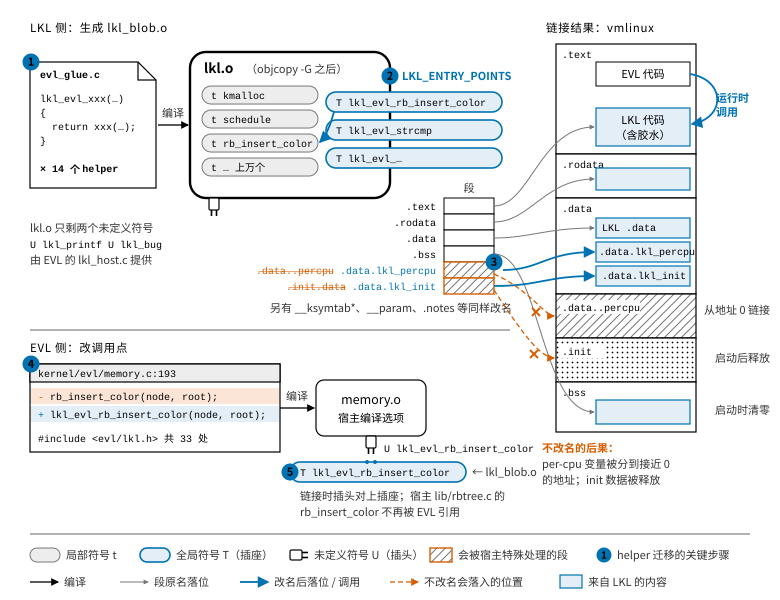

# 构建流程：把 LKL 链接进 EVL



```
LKL 源码 ──(裁剪配置 + LKL_KABI=y)──> vmlinux ──(objcopy -G)──> lkl.o
   ──(objcopy 段重命名)──> kernel/evl/lkl_blob.o_shipped
   ──(kbuild _shipped 规则)──> evl.o ──> vmlinux（宿主）
```

## 1. 裁剪 LKL 配置

```bash
cd ~/xenoami/lkl
make ARCH=lkl O=../build/lkl-kabi defconfig
./scripts/config --file ../build/lkl-kabi/.config \
  -d PCI -d NET -d BLOCK -d VIRTIO_MMIO -d VIRTIO_MENU -d VIRTIO
make ARCH=lkl O=../build/lkl-kabi olddefconfig
grep -E "^CONFIG_(64BIT|PCI|NET|VIRTIO[A-Z_]*|BLOCK)=" ../build/lkl-kabi/.config   # 应只剩 CONFIG_64BIT=y
```

- 这三条命令只改配置，不编译。
- 关 `PCI` 最重要：否则会有 `.pci_fixup` 段，宿主会对自己的 PCI 设备执行 LKL 的 fixup。
- **坑**：只关 `VIRTIO` 没用。`VIRTIO_MMIO`（defconfig 里是 `y`）会 `select VIRTIO`（`drivers/virtio/Kconfig:152` 起），`olddefconfig` 会重新打开。用 `-d` 关选项后要回头检查；查是谁 select 的：`menuconfig` 里 `/` 搜索看 `Selected by:`。

## 2. 胶水函数（LKL 侧）

- `arch/lkl/kernel/evl_glue.c`：14 个 `lkl_evl_*` 包装函数（见 [05](05-dependency-inventory.md) A 类）。不能加 `static`；签名对照 LKL 头文件原声明。
- `arch/lkl/kernel/Makefile`：`obj-y` 加 `evl_glue.o`。
- `arch/lkl/Makefile`：`LKL_ENTRY_POINTS += lkl_evl_...`（漏加的会被 `-G` 变成局部符号，宿主链接报 undefined reference）。
- 可选：加一个 `arch/lkl/include/asm/evl_glue.h` 放声明，消除 `-Wmissing-prototypes` 警告。

## 3. 按内核 ABI 编译 LKL

### `arch/lkl/Makefile` 的修改

```make
ifneq (,$(filter elf64 elf32,$(exec_format)))
ifeq ($(LKL_KABI),y)
# Build LKL to be linked into a host kernel (e.g. the EVL core)
KBUILD_CFLAGS += -fno-pic -mcmodel=kernel -mno-red-zone \
                 -mno-sse -mno-sse2 -mno-mmx -mno-3dnow -mno-avx \
                 -mno-80387 -mno-fp-ret-in-387 -mpreferred-stack-boundary=3
else
KBUILD_CFLAGS += -fPIC
endif
```

| 选项 | 作用 |
|---|---|
| `-fno-pic` | 去掉用户态的 `-fPIC`；否则有 GOT 重定位，内核链接脚本断言 `.got` 为空 |
| `-mcmodel=kernel` | 按内核地址模型（最高 2GB）生成代码 |
| `-mno-red-zone` | 中断会覆盖 red zone |
| `-mno-sse` 等 | 内核里不能随便用 FPU/SIMD |
| `-mpreferred-stack-boundary=3` | 内核栈只保证 8 字节对齐 |

栈保护、`-fcf-protection`、`-fno-PIE` 由顶层 Makefile 按配置自动加，不用手动处理。

**为什么不能用 KCFLAGS**：本来以为 KCFLAGS 在最后、`-fno-pic` 能覆盖 `-fPIC`。但 LKL 没有 `arch/lkl/Kbuild`，kbuild 进入 `arch/lkl` 目录时把 `arch/lkl/Makefile` 当作该目录的 kbuild 文件再 include 一次（`scripts/Makefile.build:41`），`-fPIC` 被追加到 KCFLAGS 后面，且传给子目录。结果 `arch/lkl/` 下所有文件报 `code model kernel does not support PIC mode`。

### 编译与检查

```bash
make ARCH=lkl O=../build/lkl-kabi LKL_KABI=y -j64
cd ../build/lkl-kabi
nm -u lkl.o                                             # ① 只剩 lkl_bug、lkl_printf（无 _GLOBAL_OFFSET_TABLE_）
nm -g --defined-only lkl.o | grep -c lkl_evl_           # ② 14
readelf -rW lkl.o | grep -c GOTPCREL                    # ③ 0
objdump -d lkl.o | grep -c xmm                          # ④ 0
for f in $(nm lkl.o | awk '/ T lkl_evl_/{print $3}'); do  # ⑤ 胶水函数不间接调 memcpy/memset
  objdump -d --disassemble=$f lkl.o | grep -E "call.*(memcpy|memset|memmove)" && echo "!! $f"
done
```

`lkl_bug`、`lkl_printf` 是 LKL 内核代码要求宿主提供的两个函数（`arch/lkl/include/uapi/asm/host_ops.h:236-237`）。第 ⑤ 项：LKL 的 memcpy 转调 `lkl_ops->memcpy`，而 L0 场景下不初始化 `lkl_ops`，调到就是空指针崩溃。

## 4. 段重命名

宿主链接脚本会按名字把 LKL 的特殊段收进宿主自己的特殊区域，必须改名：

| LKL 的段 | 不改名的后果 | 改成 |
|---|---|---|
| `.data..percpu` | **最危险**：x86_64 SMP 内核 per-cpu 段从地址 0 开始链接，LKL 的 per-cpu 变量被分到接近 0 的地址 | `.data.lkl_percpu` |
| `.data..ro_after_init` | 宿主初始化后设为只读，LKL 再写触发页错误 | `.data.lkl_ro_after_init` |
| `.init.data` | 宿主启动结束后释放 | `.data.lkl_init` |
| `__ksymtab*`、`__kcrctab*` | LKL 导出的 `kmalloc` 等进入宿主导出表，模块可能绑定到 LKL 版本 | `.rodata.lkl_*` |
| `__param` | 宿主解析命令行时注册 LKL 的模块参数（含指向 LKL 函数的指针）| `.data.lkl_param` |
| `__modver`、`__ex_table` | 混进宿主同名表 | `.rodata.lkl_*` |
| `.pci_fixup` | 宿主对自己的 PCI 设备执行 LKL 的 fixup。关了 `PCI` 段仍然存在（链接脚本固定生成）| `.rodata.lkl_pci_fixup` |
| `.notes`（两个）| 与宿主 `.note.*` 规则对不上，成孤儿段。**不能删**：LKL 链接脚本在里面定义了 `__start_notes/__stop_notes` | `.rodata.lkl_notes` |
| `.text`、`.rodata`、`.data`、`.bss` | 保留原名。`.bss` 收进宿主 `.bss`，启动时一起清零 | 不变 |

改成 `.data.lkl_*`/`.rodata.lkl_*` 的原因：宿主链接脚本已有 `*(.data .data.[0-9a-zA-Z_]*)`、`*(.rodata .rodata.*)` 规则，会当作普通数据收进去，不产生孤儿段，不用改宿主链接脚本。

```bash
cd ~/xenoami/build/lkl-kabi
for s in _stext _etext _sinittext _einittext _text _end _sdata _edata \
         __bss_start __bss_stop __init_begin __init_end __per_cpu_start __per_cpu_end; do
  echo "$s lkl$s"
done > lkl-redefine.syms
objcopy \
  --rename-section .data..percpu=.data \
  --rename-section .data..ro_after_init=.data \
  --rename-section .init.data=.data \
  --rename-section __ksymtab=.rodata.lkl_ksymtab \
  --rename-section __ksymtab_gpl=.rodata.lkl_ksymtab_gpl \
  --rename-section __kcrctab=.rodata.lkl_kcrctab \
  --rename-section __kcrctab_gpl=.rodata.lkl_kcrctab_gpl \
  --rename-section __param=.data \
  --rename-section __modver=.rodata.lkl_modver \
  --rename-section __ex_table=.rodata.lkl_ex_table \
  --rename-section .pci_fixup=.rodata.lkl_pci_fixup \
  --rename-section .notes=.rodata.lkl_notes \
  --redefine-syms lkl-redefine.syms \
  lkl.o ~/xenoami/linux-evl/kernel/evl/lkl_blob.o_shipped
```

**2026-11-11 更正**（第一次真正链接成功）：
- 数据段原来改名为 `.data.lkl_*`，以为会被 `*(.data .data.[0-9a-zA-Z_]*)` 收进去。但这条规则只在 `CONFIG_LD_DEAD_CODE_DATA_ELIMINATION` 或 LTO 下才有（`include/asm-generic/vmlinux.lds.h:103` 对 `:110`）。x86 默认配置下 `.data` 只收 `*(.data)`，于是报 `unplaced orphan section .data.lkl_init` 等 4 个错误。现在这 4 个段直接改名为 `.data`。`.rodata.lkl_*` 能被 `*(.rodata.*)` 收进去，不用改。
- LKL 里有自己的局部符号 `__per_cpu_start/__per_cpu_end`、`_stext/_etext` 等。kallsyms 按名字找这些边界符号时会拿到 LKL 的那一份，per-cpu 的范围于是算错，报 `kallsyms failure: relative symbol value 0xffffffff81000000 out of range in relative mode`。用 `--redefine-syms` 给这 14 个符号加上 `lkl` 前缀。
- **KASLR 下启动失败**：内核没有任何输出就退出了，加上 `nokaslr` 才能正常启动。链接时 relocs 工具报了若干次 `Did you forget to use "ax"/"aw" in a .S file?`，推测 LKL 段的重定位没有进入 KASLR 的重定位表。目前用 `nokaslr` 规避，根因待查。

检查：`readelf -SW` 结果里不应再有 `__` 开头的段，也不应有 `.data..percpu`、`.init.data`、`.pci_fixup`、`.notes`。

`lkl_blob.o_shipped` 约 100MB（大部分是调试信息），加进 `linux-evl/.git/info/exclude`，不提交。

## 5. EVL 侧

- `kernel/evl/Makefile`：`evl-y += lkl_host.o lkl_blob.o`。kbuild 的 `%_shipped` 规则（`scripts/Makefile.lib:291`）把 `lkl_blob.o_shipped` 复制成 `lkl_blob.o`。
- `kernel/evl/lkl_host.c`：实现 `lkl_printf`（`vprintk`）和 `lkl_bug`（`vprintk` + `BUG()`）。以后 host_ops 也写在这里。
- `include/evl/lkl.h`：14 个 `lkl_evl_*` 声明（用宿主类型；两边布局相同）、`#define evl_ktime_to_timespec64(kt) lkl_evl_ns_to_timespec64(kt)`，以及 `lkl_printf`/`lkl_bug` 的声明。
- `kernel/evl/` 用 `-Werror` 编译：`lkl_host.c` 必须 `#include <evl/lkl.h>`，否则 `-Wmissing-prototypes` 报错。
- 替换调用点共 **37 处**（`factory.c` 2+1、`memory.c` 9、`clock.c` 6、`observable.c` 3 等），每个改过的文件（含 `clock.h`、`timer.h`、`sched/queue.h`）都加了 `#include <evl/lkl.h>`。
- 不要用 `#define strcmp lkl_evl_strcmp` 全局替换：会影响所有 include 进来的 Linux 头文件，干扰内建函数。在调用点逐个改名。
- `include/evl/timer.h` 要 `#include <evl/lkl.h>`（`rb_next`/`rb_erase` 在内联函数里）。
- 替换完检查：

```bash
cd ~/xenoami/build/linux-evl-qemu
for f in $(find kernel/evl drivers/evl -name "*.o" ! -name "built-in*" ! -name evl.o ! -name lkl_blob.o); do
  nm -u $f | grep -wE "strcmp|strncmp|strncpy|strsep|simple_strtol|hashlen_string|rb_insert_color|rb_erase|rb_next|rb_replace_node|_find_first_bit|_find_first_zero_bit|int_sqrt|ns_to_timespec64" | sed "s|^|$f: |"
done   # 应无输出
```

注意：
- 6.12 的 kbuild 不再生成 `kernel/evl/evl.o`，`evl-y` 的各个目标文件（含 `lkl_blob.o`、`lkl_host.o`）直接放进 `kernel/evl/built-in.a`，符号在链接 vmlinux 时才解析。
- 默认配置下 `include/evl/sched/queue.h` 的 `find_first_bit` 不会被编译（只在 `CONFIG_EVL_SCHED_SCALABLE` 分支里），`sched/quota.c` 也不编译。要覆盖它们，用 `build/linux-evl-full`（全选项）再查一遍。
- `kernel/evl/net/` 不在本次范围内，它仍然直接调用 Linux 的 `rb_*` 等函数。

## 6. 宿主内核配置（QEMU 用）

```bash
cd ~/xenoami/linux-evl
make O=../build/linux-evl-qemu x86_64_defconfig
./scripts/config --file ../build/linux-evl-qemu/.config \
  -e EVL -e EVL_LATMUS -d CPU_MITIGATIONS -d X86_KERNEL_IBT \
  -e DEBUG_INFO_DWARF5 -e GDB_SCRIPTS
make O=../build/linux-evl-qemu olddefconfig
make O=../build/linux-evl-qemu -j64 bzImage
```

- 关 `CPU_MITIGATIONS`（连带 retpoline 等）：否则 objtool 对 LKL 里未处理的间接跳转报错。
- 关 `X86_KERNEL_IBT`：LKL 代码里的函数指针调用没有 endbr。

| 链接报错 | 原因 |
|---|---|
| `undefined reference to lkl_evl_xxx` | 没加进 `LKL_ENTRY_POINTS` 或拼错 |
| `undefined reference to lkl_printf/lkl_bug` | `lkl_host.o` 没加进 Makefile |
| `orphan section .xxx` | 第 4 步漏改段名 |
| `relocation truncated to fit` | LKL 不是 `-mcmodel=kernel` 编译的 |

### 已知副作用

LKL 的上万个局部符号（它自己的 `kmalloc`、`schedule` 等）会进入宿主 kallsyms：`/proc/kallsyms`、kprobe、ftrace 里出现重名，`kallsyms_lookup_name("kmalloc")` 可能返回 LKL 的那一个。以后可给 LKL 局部符号统一加前缀解决。

## clangd

三个仓库根目录都有指向构建目录的 `compile_commands.json` 链接；linux-evl 和 lkl 根目录有 `.clangd`，去掉 GCC 专用选项。这些都加进了各自的 `.git/info/exclude`。重新配置后执行 `make O=<dir> compile_commands.json` 更新。
