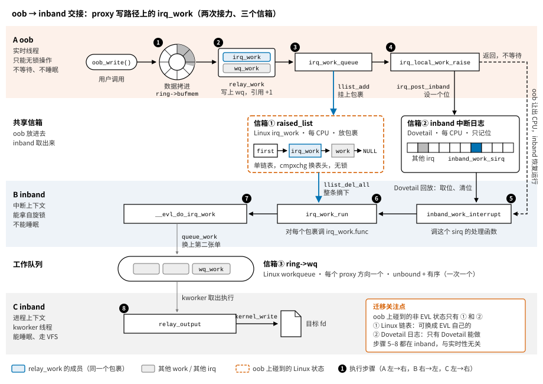

# 案例：oob 有状态依赖 `irq_work_queue`

oob 上调用的有状态 Linux 函数里，最典型的是 `irq_work_queue`：EVL 想让 inband 替它做事时都要经过它（16 个目标文件，全选项构建）。这里以 proxy 的写路径为例，讲清楚它在做什么、碰了谁的状态、迁移时该怎么处理。名词、数据结构和函数的完整说明见 [10](10-irq-work-glossary.md)。



## 1. 要解决的问题

proxy 让 oob 线程也能"写文件"。但写文件（`kernel_write`）要走 VFS，会拿 Linux 的锁、会睡眠，只能在 inband 上执行。所以 oob 线程只做两件事：

1. 把数据放进环形缓冲 `ring->bufmem`；
2. 通知 inband："有数据了，来取"。

通知这一步有严格要求：**不拿 Linux 的锁、不睡眠、不分配内存、不等待**。

### 为什么不能直接 `queue_work`

Dovetail 下 Linux 的"关中断"是虚拟的：inband 的 `spin_lock_irqsave` 只设置 stall 标志，CPU 硬中断还开着。所以 oob 可以在 inband 持有 workqueue 内部锁 `pool->lock` 时打断它。这时 oob 如果也去 `queue_work`，就会去拿同一把锁，永远自旋下去（持锁的 inband 要等 oob 让出 CPU 才能运行），结果是死锁。

**结论：oob 不能调用任何会拿 Linux 锁的函数。** 它只能用无锁的方式留一张纸条，等 inband 有机会运行时自己去看。

## 2. 三种执行环境，所以要接力两次

| 环境 | 能做 | 不能做 |
|---|---|---|
| A. oob | 原子操作、设位图等无锁操作 | 拿 Linux 锁、睡眠 |
| B. inband 中断上下文 | 拿 Linux 自旋锁（如 `queue_work`）| 睡眠 |
| C. inband 进程上下文（kworker）| 睡眠、拿 mutex、走 VFS | 没有限制 |

写文件必须在 C 里做，而 oob 在 A，所以要接力两次：

```
A ──irq_work──▶ B ──workqueue──▶ C
```

- **A → B 用 irq_work**：无锁入队，再"触发一个中断"；回调在 inband 的中断上下文执行。
- **B → C 用 workqueue**：中断上下文里可以 `queue_work`，由 kworker 线程在进程上下文执行。

## 3. 路上传的东西：`struct evl_work`（`include/evl/work.h:16`）

可以把它看成贴了两张快递单的包裹：

```c
struct evl_work {                      /* proxy 里就是 ring->relay_work */
	struct irq_work    irq_work;       /* 第一张单：A → B */
	struct work_struct wq_work;        /* 第二张单：B → C */
	struct workqueue_struct *wq;       /* 第二段送到哪个 workqueue */
	handler;                           /* 最终执行：relay_output_work */
	element;                           /* 指向 proxy，引用计数防止中途销毁 */
};
```

- 每个 proxy 的每个方向在创建时（`init_ring`，`proxy.c:650`）就准备好一个包裹，所以 oob 上不用分配内存。
- 每一段只用一张单：第一段挂 `irq_work`，第二段挂 `wq_work`。
- 每到一站，用 `container_of` 从单子找回包裹，再找回 ring 和 proxy。

`ring->wq` 是 `init_ring` 里用 `alloc_ordered_workqueue("%s.%c", ...)` 创建的，每个 proxy 方向一个（如 `foo.O`、`foo.I`）。

- **workqueue 和 CPU 的关系**：`workqueue_struct` 只是一个前端队列对象，不属于任何 CPU，可以随意创建；真正执行的是后面 worker pool 里的 kworker。"绑定 CPU"说的是普通的 bound 队列（如 `system_wq`），在哪个 CPU 上入队，就由哪个 CPU 的 pool 执行。
- **ordered 队列**展开为 `WQ_UNBOUND | __WQ_ORDERED`，`max_active = 1`：
  - 不绑 CPU，不会占用实时 CPU；
  - 严格按顺序、一次一个，写进文件的数据不会乱序；
  - 专用，`kernel_read`/`kernel_write` 长时间阻塞时只卡住这个 proxy，不拖累共享的 `system_wq`。

## 4. 三个信箱

| | 信箱① `raised_list` | 信箱② inband 中断日志 | 信箱③ `ring->wq` |
|---|---|---|---|
| 归谁 | Linux irq_work（`kernel/irq_work.c:27`）| Dovetail（`irq_stage_data.log`）| Linux workqueue |
| 每份属于 | 每个 CPU 一个 | 每个 CPU、每个 stage 一个 | 每个 proxy 方向一个 |
| 装什么 | 包裹本身（`irq_work` 节点，带回调函数）| 只有位：哪个中断号待处理 | 包裹（`wq_work` 节点）|
| 谁放 | oob：`llist_add` | oob：`irq_post_inband` | inband 中断：`queue_work` |
| 谁取 | inband 中断：`irq_work_run` | Dovetail 回放：`sync_current_irq_stage` | kworker |

### 信箱① 和 信箱② 的区别

**Dovetail 只看信箱②，不知道信箱① 的存在。** 信箱① 是 Linux irq_work 子系统的私有数据，是被信箱② 里那个位间接触发后，才由 Linux 自己的代码去清空的：

```
inband 恢复 → Dovetail 回放信箱②：发现 inband_work_sirq 这一位
            → 调这个 sirq 的处理函数 inband_work_interrupt   （Dovetail 只做到这里）
            → irq_work_run 清空信箱①，逐个执行回调           （Linux 自己的代码）
```

两者的区别：

- **信箱② 是门铃，信箱① 是信箱。**
  - 信箱② 是按中断号索引的固定大小位图，只能表示"某个中断待处理"，不能带内容；同一位设两次和设一次一样。
  - 信箱① 是不限长度的链表，装的是具体的工作项和回调函数。
  - 所有 irq_work 共用信箱② 里的同一位（`inband_work_sirq`）。
- **信箱② 是通用机制，不只给 irq_work 用。** oob 运行期间到达的、属于 inband 的硬件中断（定时器、网卡……）也记在这里，等 inband 恢复时回放。
- **信箱② 其实是软件版的中断控制器。** 原版 Linux 没有它：`arch_irq_work_raise` 给自己发一个 APIC 自 IPI，"有中断待处理"的状态记在硬件里。Dovetail 把中断虚拟化后，把这个状态放进了软件日志。`irq_local_work_raise` 被 Dovetail 用强符号替换（`kernel/irq/pipeline.c:1715`），把"发 IPI"改成"记日志"。

`llist_add` 只在信箱① 原来为空时才返回 true，所以只有第一个包裹会按门铃；后面的包裹进来时门铃已经按过、信箱① 还没被清空，不用再按。

### 信箱① 为什么能无锁 add

信箱① 是**单链表，只在表头插入，取的时候整条摘下**，所以用一条原子指令就够了（`lib/llist.c:26`）：

```c
first = READ_ONCE(head->first);
do {
	new->next = first;                              /* 新节点指向当前表头 */
} while (!try_cmpxchg(&head->first, &first, new));  /* 表头没变才换成 new */
```

`cmpxchg`（x86 上是 `lock cmpxchg`）是一条原子指令：如果 `head->first` 仍等于 `first`，就改成 `new` 并返回成功；否则把当前值读进 `first`，返回失败，循环重试。

在这里，真正的并发来自同一个 CPU 上的两个 stage：

1. inband 正在 `llist_add`（Linux 自己也用 irq_work），刚执行完 `new->next = first`；
2. oob 打断它，也 `llist_add`，`cmpxchg` 成功，表头变了；
3. inband 恢复，它的 `cmpxchg` 发现表头已经不是 `first`，失败，重读后重试。

**重试的总是被打断的那个，没有谁需要等谁**，所以 oob 不会被 inband 卡住。换成加锁就是第 1 节里的死锁。

取的一方用 `llist_del_all`，也就是 `xchg(&head->first, NULL)`，一次把整条链摘下来再慢慢处理。因为从不单独删中间或表头的某个节点，所以不存在 ABA 问题。

信箱② 是本 CPU 私有的，而且 `irq_post_stage` 在关硬中断时执行，同一个 CPU 上没人能打断它，用普通的 `__set_bit` 就够了。

## 5. 完整时序

**A：oob 线程（同步完成，不等待）**

| 步骤 | 函数 | 位置 | 作用 |
|---|---|---|---|
| 1 | `proxy_oob_write` → `do_proxy_write` | `proxy.c:398`、`:159` | 拿 `ring->lock`（硬锁），预留空间，`raw_copy_from_user` 拷进缓冲。缓冲从空变成非空、而且不在 inband 时才继续 |
| 2 | `evl_call_inband_from` | `work.c:85` | `relay_work.wq = ring->wq`；`evl_get_element` 给 proxy 引用 +1 |
| 3 | `irq_work_queue` | `irq_work.c:116` | `irq_work_claim` 标 PENDING（已在排队就返回）；`__irq_work_queue_local` → `llist_add` 挂进信箱① |
| 4 | `irq_local_work_raise` | `pipeline.c:1715` | 关硬中断，`irq_post_inband(inband_work_sirq)` → `irq_post_stage` 在信箱② 设位；随后返回用户态 |

**B：inband 中断上下文（oob 让出 CPU 后）**

| 步骤 | 函数 | 位置 | 作用 |
|---|---|---|---|
| 5 | `sync_current_irq_stage` → `do_inband_irq` → `inband_work_interrupt` | `pipeline.c:1322`、`:979`、`:1702` | 回放日志：`pull_next_irq` 取位、清位，调用处理函数。触发时机：inband 从被抢占的中断退出时（`handle_irq_pipelined_finish` → `synchronize_pipeline_on_irq`），或 inband 解除 stall 时（`__inband_irq_enable`）|
| 6 | `irq_work_run` → `irq_work_run_list` → `irq_work_single` | `irq_work.c:274`、`:256`、`:203` | `llist_del_all` 摘下信箱①；对每个包裹清 PENDING，调 `irq_work.func` |
| 7 | `__evl_do_irq_work` | `work.c:37` | `queue_work(work->wq, &work->wq_work)`，挂进信箱③ |

**C：kworker**

| 步骤 | 函数 | 位置 | 作用 |
|---|---|---|---|
| 8 | `__evl_do_work` → `relay_output_work` → `relay_output` | `work.c:9`、`proxy.c:145`、`:75` | 拿 `worker_lock`，`kernel_write` 写目标 fd；`evl_raise_flag` 唤醒等缓冲的 oob 写者；`evl_put_element` 退回引用 |

## 6. 迁移分析

| 步骤 | 在哪执行 | 碰了谁的状态 | 对实时性 |
|---|---|---|---|
| 1–2 | oob | 环形缓冲、元素引用计数（EVL）| — |
| 3 | oob | 信箱①（Linux）| **关键** |
| 4 | oob | 信箱②（Dovetail）| **关键**，但只有 Dovetail 能做 |
| 5–7 | inband 中断 | 信箱①②③ | 无关 |
| 8 | kworker | VFS、mutex | 无关 |

**直接换成 LKL 的 `irq_work_queue` 不行**（`lkl.o` 里有，是局部符号，`CONFIG_IRQ_WORK=y`）：

| 问题 | 原因 |
|---|---|
| 原子性失效 | LKL 用 generic `cmpxchg.h`（`arch/lkl/include/asm/Kbuild:3`），靠关 LKL 的虚拟中断实现，不是真正的 SMP 原子操作；`CONFIG_BROKEN_ON_SMP=y` |
| per-CPU 只有一份 | LKL 是单 CPU，所有宿主 CPU 共用一个 `raised_list` |
| 按不了门铃 | LKL 的 `arch_irq_work_raise` 是空的弱函数 |

如果改成进入 LKL 上下文再调用（`lkl_evl_call`），要拿 LKL 的 CPU 锁，可能被 inband 调用者占着，违反原则 1。

**可选方案**（详见 [08](08-open-questions.md) 第 2 节）：

- **(a) EVL 自己持有信箱①（倾向）**：EVL 维护自己的 per-CPU llist（`llist_del_all` 是内联的 `xchg`；`llist_add` 只是内联包装，实际调用 `lib/llist.c:26` 的 `llist_add_batch`，一个只读写参数的 `try_cmpxchg` 循环，属于 L0。但它**不能交给 LKL**：LKL 的 `try_cmpxchg` 是靠关 LKL 中断实现的通用版，不是 SMP 原子操作。所以要么继续链接宿主的版本，要么由 EVL 自己写这几行循环），门铃直接用 Dovetail 的 `irq_post_inband`，inband 处理函数清空 EVL 自己的链表。不碰 RT 路径，EVL 只多几十行，去掉了对 Linux irq_work 子系统的依赖。
- **(b) 用 LKL 的代码，状态由 EVL 提供**：链表按宿主 CPU 分开，cmpxchg 换成宿主实现，加一个 host_op `irq_work_raise`。LKL 改动大。
- **(c) 不动**：归为第三类，继续用 Linux 的。

不管哪种方案，信箱② 都只能由 Dovetail 提供。步骤 5–8 都在 inband 上，以后和 `queue_work`、`hash_lock` 一起作为 inband 有状态依赖处理。

## 7. 阅读顺序

1. `kernel/evl/proxy.c:159-230`（`do_proxy_write`）、`:624-660`（`init_ring`）
2. `include/evl/work.h:16`、`kernel/evl/work.c:9-108`
3. `kernel/irq_work.c:57-127`、`:203-280`；`lib/llist.c:26`
4. `kernel/irq/pipeline.c:613`（`irq_post_stage`）、`:1322`（`sync_current_irq_stage`）、`:1700-1730`
5. 对照 LKL：`kernel/irq_work.c`、`include/asm-generic/cmpxchg.h`
