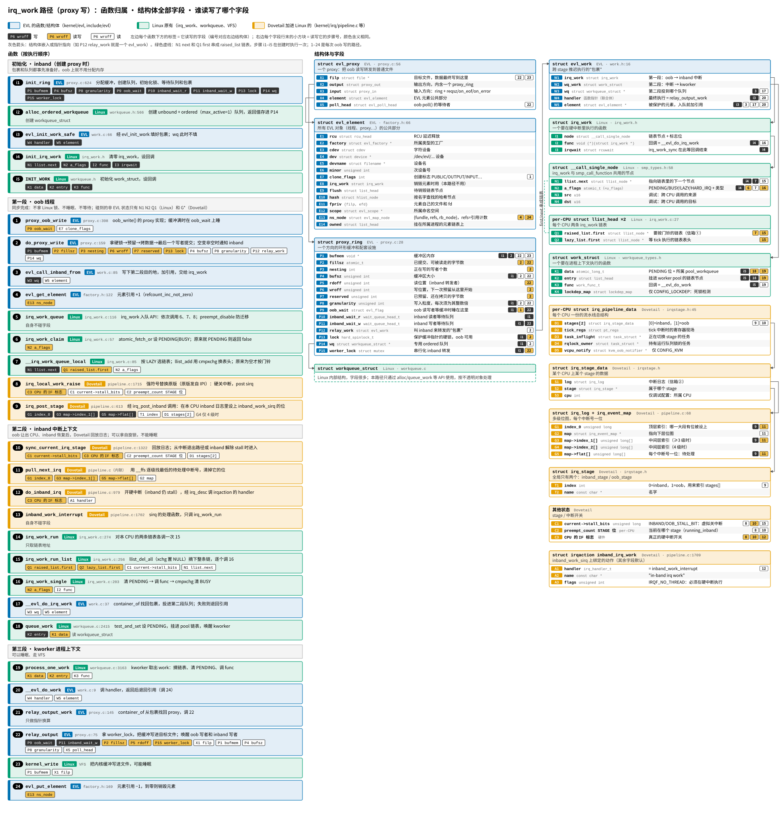

# irq_work 路径上的名词、数据结构和函数

配合 [09](09-case-oob-irq-work.md) 阅读。

全景图：函数按归属着色，列出所有相关结构体的全部字段，并标出每个函数读写了哪些字段（`figs/irq-work-fields.svg`，由 `figs/src/gen_fields.py` 生成，改数据后重跑即可）。


按"名词 → 数据结构 → 函数 → 标志位状态机"组织，每一项都标出归属：【L】Linux 原有，【D】Dovetail 加的，【E】EVL。

## 一、名词

### 执行环境

| 名词 | 含义 |
|---|---|
| **stage**【D】| Dovetail 把 CPU 上的执行分成两个"舞台"：`oob_stage`（实时，优先级高）和 `inband_stage`（普通 Linux）。oob 随时可以打断 inband，反过来不行 |
| **oob**（out-of-band）| 在 oob stage 上执行。EVL 的实时线程、oob 中断处理都在这里 |
| **inband** | 在 inband stage 上执行，也就是原来的整个 Linux |
| **中断流水线**（interrupt pipeline）【D】| Dovetail 的核心：所有硬件中断先进流水线入口，属于 oob 的立即处理，属于 inband 的先记进 log，等 inband 能运行时再回放 |
| **硬中断上下文** | 在中断处理函数里执行，不能睡眠。irq_work 的回调就在这里执行 |
| **进程上下文** | 在某个线程里执行，可以睡眠。kworker 执行的 work 就在这里 |

### 关中断的两种含义

| 名词 | 含义 |
|---|---|
| **stall**（虚拟关中断）【D】| Dovetail 下，Linux 的 `local_irq_save/disable` 不再真正关闭 CPU 中断，只是给 inband stage 设置一个 stall 标志（`task_struct.stall_bits` 的 `INBAND_STALL_BIT`）。inband 被 stall 期间，属于 inband 的中断只记进 log、不执行；oob 照常运行 |
| **硬关中断**【D】| `hard_local_irq_save/restore`，真正执行 `cli/sti`，oob 也无法打断。只在极短的关键区使用 |

正是因为 Linux 的关中断挡不住 oob，oob 才不能拿 Linux 的锁：inband 持锁时可能被 oob 打断，oob 再去拿同一把锁就会死锁。

### 中断相关

| 名词 | 含义 |
|---|---|
| **中断日志**（irq log）【D】| 每个 CPU、每个 stage 一份的位图，记录"哪些中断号待处理"。只有位，没有内容，同一位设两次等于一次 |
| **post**（记日志）【D】| 在某个 stage 的 log 里设一个位：`irq_post_stage` / `irq_post_inband` |
| **sync / 回放**【D】| stage 能运行而且没被 stall 时，把 log 里的位逐个取出，调用对应的中断处理函数：`sync_current_irq_stage` |
| **sirq**（synthetic irq，合成中断）【D】| Dovetail 在软件里虚拟出来的中断号，没有对应的硬件。只能通过 post 触发 |
| **`inband_work_sirq`**【D】| 专门给 irq_work 用的那个 sirq，Dovetail 下 irq_work 的"门铃" |
| **IPI**（处理器间中断）| CPU 之间通过中断控制器（APIC）发送的硬件中断 |
| **自 IPI** | CPU 给自己发 IPI。原版 Linux 中 irq_work 的门铃（`IRQ_WORK_VECTOR`）|

### 并发与编程手法

| 名词 | 含义 |
|---|---|
| **per-CPU 变量** | 每个 CPU 各有一份的变量，`DEFINE_PER_CPU` 定义，`this_cpu_ptr` 取本 CPU 那一份 |
| **cmpxchg** | 比较并交换，一条原子指令（x86 上是 `lock cmpxchg`）：内存里的值等于预期值才写入新值，否则失败 |
| **xchg** | 原子交换：写入新值并返回旧值 |
| **无锁**（lock-free）| 只靠原子指令保证正确，不用锁。失败的一方重试，没有谁会等谁 |
| **强符号 / 弱符号** | 函数用 `__weak` 声明就是弱符号；链接时如果有同名的普通（强）定义，就用强的。Dovetail 用这种方式替换了 `irq_local_work_raise` |
| **嵌入式节点 + `container_of`** | Linux 惯用写法：把链表节点、work 等结构体嵌在使用者的对象里；拿到成员指针后，用 `container_of(ptr, 外层类型, 成员名)` 算出外层对象的地址。好处是入队不用分配内存 |
| **引用计数** | 对象被使用期间计数加一，用完减一，减到零才能释放。EVL 用它保证 inband 执行时 proxy 还没被销毁 |

### workqueue

| 名词 | 含义 |
|---|---|
| **work** | 一个要在进程上下文里执行的函数（`struct work_struct`）|
| **workqueue** | 一个前端队列对象（`struct workqueue_struct`），带名字和属性，可以任意创建 |
| **kworker / worker pool** | 真正执行 work 的内核线程和线程池。bound pool 每个 CPU 一个，unbound pool 不绑 CPU |
| **bound / unbound** | bound 队列：在哪个 CPU 上入队就由哪个 CPU 执行（如 `system_wq`）。unbound：由不绑 CPU 的线程池执行 |
| **ordered** | 同一时间最多执行一个 work，而且严格按入队顺序执行（`max_active = 1`）|

## 二、数据结构

### 全景：谁嵌在谁里面

```
struct evl_proxy                                   【E】proxy.c:56
 ├ filp                       目标文件
 ├ element                    EVL 元素（引用计数）
 └ output.ring : struct proxy_ring                 【E】proxy.c:28
     ├ bufmem / bufsz / rdoff / wroff / fillsz / reserved / nesting   环形缓冲
     ├ lock          hard_spinlock_t（硬锁，oob 可用）
     ├ oob_wait      evl_flag（oob 写者等缓冲时睡在这里）
     ├ wq ─────────────────────────────▶ struct workqueue_struct   【L】"foo.O"，ordered
     └ relay_work : struct evl_work                【E】work.h:16
         ├ irq_work : struct irq_work              【L】irq_work.h
         │    ├ node : struct __call_single_node   【L】smp_types.h:58
         │    │    ├ llist : struct llist_node  ──▶ 挂进 per-CPU raised_list
         │    │    └ a_flags : atomic_t           PENDING / BUSY / LAZY / ...
         │    ├ func = __evl_do_irq_work
         │    └ irqwait                           irq_work_sync 等待用
         ├ wq_work : struct work_struct           【L】──▶ 挂进 ring->wq
         │    └ func = __evl_do_work
         ├ wq            第二段的目的地（evl_call_inband_from 时写入）
         ├ handler       = relay_output_work
         └ element       = &proxy->element
```

### EVL

**`struct evl_work`**（`include/evl/work.h:16`）：跨 stage 推迟执行的"包裹"。

| 字段 | 作用 |
|---|---|
| `irq_work` | 第一段 oob → inband 中断上下文 |
| `wq_work` | 第二段 inband 中断上下文 → kworker |
| `wq` | 第二段投递到哪个 workqueue |
| `handler` / `handler_noreturn` | 最终要执行的函数（联合体：同步版本有返回值，异步版本没有）|
| `element` | 要保护的 EVL 元素；非空时入队前加引用，执行完减引用 |

**`struct proxy_ring`**（`proxy.c:28`）：proxy 一个方向的环形缓冲和配套设施。这条路径上用到：`bufmem` 等缓冲字段、`lock`、`relay_work`、`wq`、`oob_wait`、`worker_lock`（`relay_output` 里串行化转发）。

**`struct evl_element`**（`include/evl/factory.h:66`）：EVL 所有对象（线程、proxy、monitor……）的公共部分，包含引用计数，以及 `/dev/evl/...` 设备节点。

### Linux irq_work

**`struct irq_work`**（`include/linux/irq_work.h`）

| 字段 | 作用 |
|---|---|
| `node` | 链表节点和标志位（见下）|
| `func` | 回调函数，在硬中断上下文执行 |
| `irqwait` | `irq_work_sync` 等待回调执行完时使用 |

**`struct __call_single_node`**（`include/linux/smp_types.h:58`）：irq_work 和 smp_call_function 共用的节点类型。

| 字段 | 作用 |
|---|---|
| `llist` | 无锁链表节点 |
| `a_flags`（与 `u_flags` 联合）| 标志位，原子访问 |
| `src` / `dst` | 调试用，记录跨 CPU 调用的来源和目标 |

**标志位**（`smp_types.h:10-20`）

| 标志 | 值 | 含义 |
|---|---|---|
| `IRQ_WORK_PENDING` | 0x01 | 已入队，还没开始执行 |
| `IRQ_WORK_BUSY` | 0x02 | 已入队或正在执行 |
| `IRQ_WORK_CLAIMED` | 0x03 | `PENDING \| BUSY`，入队时一起设上 |
| `IRQ_WORK_LAZY` | 0x04 | 不按门铃，等 tick |
| `IRQ_WORK_HARD_IRQ` | 0x08 | PREEMPT_RT 下也要在硬中断里执行 |
| `CSD_TYPE_IRQ_WORK` | 0x20 | 节点类型：这是一个 irq_work（区别于 smp_call_function）|

**`struct llist_head` / `struct llist_node`**（`include/linux/llist.h:56-62`）：最简单的单链表，表头只有一个 `first` 指针，节点只有一个 `next` 指针。

**`raised_list` / `lazy_list`**（`kernel/irq_work.c:27-28`）：`DEFINE_PER_CPU(struct llist_head, ...)`，每个 CPU 两条链表，前者要按门铃，后者等 tick。

### Dovetail

```
per-CPU struct irq_pipeline_data irq_pipeline      irqstage.h:57
 └ stages[2] : struct irq_stage_data               [0] inband, [1] oob
     ├ stage → struct irq_stage {index, name}      inband_stage / oob_stage 两个全局对象
     └ log : struct irq_log
         ├ index_0                                 顶层索引位图
         └ map → struct irq_event_map              pipeline.c:68
               ├ index_1[] (/ index_2[])           中间层索引
               └ flat[]                            每个中断号一位
task_struct.stall_bits                             INBAND_STALL_BIT / OOB_STALL_BIT
```

| 结构 | 作用 |
|---|---|
| `struct irq_stage` | 一个 stage 的身份：编号和名字。全局只有两个对象，`inband_stage` 和 `oob_stage` |
| `struct irq_stage_data` | 某个 CPU 上某个 stage 的数据，主要就是它的 log |
| `struct irq_log` + `struct irq_event_map` | 多级位图：`flat` 每个中断号一位，上面几级索引记录"哪一段里有位被设上"，这样 `pull_next_irq` 用几次 `__ffs` 就能找到最低的待处理中断，不用逐个扫描 |
| `struct irq_pipeline_data` | per-CPU 总结构，内含两个 stage 的数据 |
| `task_struct.stall_bits` | stall 标志放在当前任务里 |
| `inband_work_sirq` + `inband_irq_work` | sirq 号，和绑定在它上面的 `irqaction`（处理函数 `inband_work_interrupt`）。启动时在 `irq_pipeline_init`（`pipeline.c:1864`）里创建 |

### Linux workqueue

| 结构 | 作用 |
|---|---|
| `struct work_struct` | 一个 work：链表节点 + 函数指针 `func` |
| `struct workqueue_struct` | 一个队列，带名字、属性，指向它使用的 worker pool |
| `system_wq` | 系统默认的 bound 队列，`evl_call_inband` 默认用它 |

## 三、函数

### 初始化（创建 proxy 时，inband）

| 函数 | 归属 | 作用 |
|---|---|---|
| `init_ring` | 【E】`proxy.c:624` | 分配缓冲；`alloc_ordered_workqueue` 创建 `ring->wq`；用 `evl_init_work_safe` 初始化 `relay_work` |
| `alloc_ordered_workqueue` | 【L】`workqueue.h:566` | 宏，展开为 `alloc_workqueue(fmt, WQ_UNBOUND \| __WQ_ORDERED, 1)` |
| `evl_init_work_safe` → `evl_init_work` | 【E】`work.c:50-66` | 填好 `irq_work.func = __evl_do_irq_work`、`wq_work.func = __evl_do_work`、`handler`、`element` |
| `init_irq_work` | 【L】`irq_work.h` | 把 irq_work 清零，设上 `func` |
| `INIT_WORK` | 【L】 | 初始化 work_struct，设上 `func` |

### 第一段：oob 线程

| 函数 | 归属 | 作用 |
|---|---|---|
| `handle_oob_syscall` → `do_oob_syscall` | 【E】`syscall.c:504/263` | oob 系统调用入口和分发 |
| `EVL_SYSCALL(write)` | 【E】`syscall.c:70` | 找到 EVL 文件，调用 `f_op->oob_write` |
| `proxy_oob_write` | 【E】`proxy.c:398` | 循环调 `do_proxy_write`；缓冲满时在 `oob_wait` 上睡眠 |
| `do_proxy_write` | 【E】`proxy.c:159` | 拿硬锁、预留空间、拷贝数据；缓冲从空变成非空时调 `evl_call_inband_from` |
| `raw_copy_from_user` | 【L】 | 从用户空间拷贝，不做额外检查 |
| `evl_call_inband_from` | 【E】`work.c:85` | 写入 `work->wq`，`evl_get_element`，调 `irq_work_queue`；失败（已在排队）就退回引用 |
| `evl_get_element` | 【E】`factory.h:122` | 元素引用加一 |
| `irq_work_queue` | 【L】`irq_work.c:116` | irq_work 的入队 API：claim → 挂链表 → 按门铃 |
| `irq_work_claim` | 【L】`irq_work.c:57` | `atomic_fetch_or` 设上 `CLAIMED \| CSD_TYPE_IRQ_WORK`；原来就是 PENDING 的返回 false |
| `__irq_work_queue_local` | 【L】`irq_work.c:85` | 选 `raised_list` 或 `lazy_list`；`llist_add`；链表原来为空才按门铃 |
| `llist_add` → `llist_add_batch` | 【L】`lib/llist.c:26` | `try_cmpxchg` 循环换表头；返回"原来是否为空" |
| `irq_local_work_raise` | 【D】`pipeline.c:1715` | 强符号，覆盖 `irq_work.c:79` 的弱版本。硬关中断，post `inband_work_sirq`；调用者在 inband 且中断开着就当场回放 |
| `irq_post_inband` → `irq_post_stage` | 【D】`irqstage.h:287`、`pipeline.c:613` | 在本 CPU inband log 的位图里设上这个中断号的位（`flat` 和各级索引）|
| `arch_irq_work_raise` | 【L】`arch/x86/kernel/irq_work.c:27` | 原版的门铃：发自 IPI。Dovetail 下这条路径不走 |

### 第二段：inband 中断上下文

| 函数 | 归属 | 作用 |
|---|---|---|
| `handle_irq_pipelined_finish` | 【D】`pipeline.c:1209` | 中断退出路径；inband 从被抢占的中断里恢复时经过这里 |
| `synchronize_pipeline_on_irq` | 【D】`irq_pipeline.h:37` | 需要时调 `sync_irq_stage` |
| `__inband_irq_enable` | 【D】`pipeline.c:255` | inband 解除 stall（`local_irq_enable`）时，如果 log 里有东西就回放。另一个回放时机 |
| `sync_irq_stage` | 【D】`pipeline.c:204` | 从高到低检查每个 stage：没 stall 而且有待处理就回放 |
| `sync_current_irq_stage` | 【D】`pipeline.c:1322` | stall 当前 stage，循环 `pull_next_irq` + 调处理函数，最后解除 stall |
| `pull_next_irq` | 【D】`pipeline.c`（内联）| 用 `__ffs` 逐级找到最低的待处理中断号，清掉它的位 |
| `do_inband_irq` | 【D】`pipeline.c:979` | 打开硬中断（inband 仍 stall），走这个 irq 的流处理函数，最后调用到 irqaction 的 handler |
| `inband_work_interrupt` | 【D】`pipeline.c:1702` | `inband_work_sirq` 的处理函数，只调 `irq_work_run` |
| `irq_work_run` | 【L】`irq_work.c:274` | 处理本 CPU 的 `raised_list` 和 `lazy_list` |
| `irq_work_run_list` | 【L】`irq_work.c:256` | `llist_del_all` 摘下整条链，逐个调 `irq_work_single` |
| `llist_del_all` | 【L】`llist.h:264` | `xchg(&head->first, NULL)` |
| `irq_work_single` | 【L】`irq_work.c:203` | 清 PENDING → `smp_mb` → 调 `func` → cmpxchg 清 BUSY |
| `__evl_do_irq_work` | 【E】`work.c:37` | `container_of` 找回 `evl_work`；`queue_work(work->wq, &work->wq_work)`；失败就退回引用 |
| `queue_work` | 【L】workqueue | 把 work 挂进队列，唤醒 kworker |

### 第三段：kworker

| 函数 | 归属 | 作用 |
|---|---|---|
| `__evl_do_work` | 【E】`work.c:9` | `container_of` 找回 `evl_work`；调 `handler_noreturn`；`evl_put_element` 退回引用 |
| `relay_output_work` | 【E】`proxy.c:145` | `container_of` 找回 proxy，调 `relay_output` |
| `relay_output` | 【E】`proxy.c:75` | 拿 `worker_lock`，循环 `kernel_write`，更新 `fillsz`；通知 poll、唤醒 oob 写者和 inband 写者 |
| `kernel_write` | 【L】VFS | 从内核缓冲写文件 |
| `evl_raise_flag` | 【E】 | 唤醒在 `evl_flag` 上等待的 oob 线程，可能立即切回 oob |
| `evl_put_element` | 【E】`factory.h:169` | 元素引用减一 |

### 收尾（销毁 proxy 时）

| 函数 | 归属 | 作用 |
|---|---|---|
| `destroy_ring` → `evl_cancel_work` | 【E】`proxy.c:661`、`work.h:83` | `irq_work_sync` 等第一段完成，`cancel_work_sync` 取消第二段，再 `destroy_workqueue` |
| `irq_work_sync` | 【L】`irq_work.c:286` | 等 BUSY 清除，也就是回调执行完 |

## 四、irq_work 的标志位状态机

```
          irq_work_claim                 irq_work_single 开始              irq_work_single 结束
 空闲 ───────────────────▶ 已入队 ─────────────────────────▶ 执行中 ───────────────────────▶ 空闲
 (0)    设 PENDING|BUSY   (PENDING|BUSY)    清 PENDING      (BUSY)    cmpxchg 清 BUSY      (0)
                               │                              │
                               │ 再次 irq_work_queue           │ 再次 irq_work_queue
                               ▼                              ▼
                          返回 false                      可以重新入队（又变成 PENDING|BUSY），
                         （不重复入队）                    执行完时 cmpxchg 失败，BUSY 保留
```

- **PENDING** 管"会不会重复入队"：设着就拒绝再次入队。所以同一个包裹不会在链表里出现两次。
- **BUSY** 管"能不能释放"：设着说明还在队列里或正在执行，`irq_work_sync` 会等它清掉。
- 执行前先清 PENDING，所以回调执行期间可以重新入队，不会丢掉新的请求。
